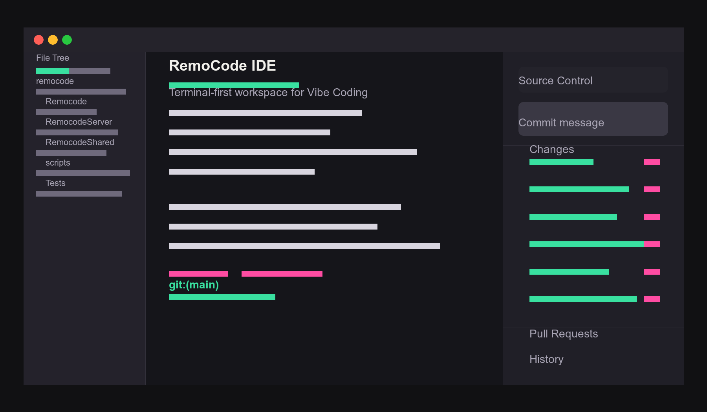

<div align="center">

# RemoCode IDE

### 终端优先的 macOS 原生 IDE — 为 Vibe Coding 而生

离开工位时，用 iOS / Android App 继续指挥 Agent。

[](https://github.com/BlueOriginAI/RemocodeIDE/releases/latest)
[](https://github.com/BlueOriginAI/RemocodeIDE/releases/latest)
[](https://github.com/BlueOriginAI/RemocodeIDE/releases/latest)
[](https://github.com/BlueOriginAI/RemocodeIDE/releases)

**[⬇️ 下载最新版](https://github.com/BlueOriginAI/RemocodeIDE/releases/latest)** · **[🌐 官网 ide.remocode.cc](https://ide.remocode.cc)** · **[📱 移动端远程控制](https://ide.remocode.cc/#remote)**

<br/>



</div>

---

## 为什么是 RemoCode

> 传统 IDE 是文件中心，RemoCode 是任务中心：先看正在跑的东西，再看需要改的代码。

> Vibe Coding 不是自动补全，而是人、终端、Git、Agent 共同迭代。IDE 必须把这些状态放在一个可扫视的界面里。

> macOS 原生体验保留了桌面工具的速度和质感，同时通过远程配置接入云端算力和持续运行的工作区。

|  |  |  |
| :-- | :-- | :-- |
| **⌨️ Terminal-first** | **🌿 Git-aware** | **📡 Remote-ready** |
| 启动即进入执行现场 | 变更树和 PR 都在右侧面板 | iOS / Android App 远程控制 Mac 工作区 |

---

## 把编码现场整理成一个连续界面

### 🖥 命令行是第一现场
启动默认进入终端，文件、Git、Agent 输出都围绕当前工作区展开，减少在编辑器和 shell 之间反复切换。

### 🌿 Git 面板贴着工作流走
变更树、提交、PR、历史记录和远程同步在同一个上下文里完成，适合多分支、多 worktree 的 Vibe Coding 节奏。

### 🤖 为 Agent 协作设计
RemoCode 把终端会话、文件树、变更状态和上下文保留在 IDE 内，让人和 Agent 可以围绕同一个工作面推进。

### 📱 移动端远程控制
配套 iOS / Android App 后，人不在 Mac 前也能给 Claude Code、Codex 派任务、看进度、收结果，IDE 持续在线干活。

---

## 人在外面，Agent 在 Mac 上继续干活

打开 RemoCode iOS / Android App，扫码配对你的 Mac，就能在手机上发任务、盯进度、收结果，回到工位时改动已在 Git 面板里等你。

- **📱 手机就是遥控器** — 在 iOS / Android App 里发一条命令，Mac 上的 IDE 立即启动 Agent 开始执行。
- **🔐 扫码配对，本机批准** — 配对信息保存在 Mac 和手机本机；首次连接需要在 Mac 上确认，无需账号或端口转发。
- **📥 结果实时回传** — Agent 的执行进度、终端输出和变更摘要直接回到手机，随时接住上下文。

```text
# RemoCode Remote                                              ● 已连接

你          run 修复登录页在窄屏下的布局问题
RemoCode    ▶ 已在 remocode-ide 启动 Claude Code，开始处理…
RemoCode    ✓ 完成：globals.css、login-panel.tsx 共 2 个文件已修改，构建通过。
你          status
RemoCode    ● 已连接 · 当前无运行中任务 · 工作树 main 干净
```

---

## Vibe Coding 工作流

1. 打开项目后直接回到终端上下文
2. 让 Agent 改代码，同时在文件树和 Git 面板里检查影响面
3. 用树状变更视图整理提交，必要时切换 PR 和历史记录
4. 出门后在 iOS / Android App 上继续给 Agent 派任务
5. 回到工位后在 Git 面板里检查、整理并提交移动端触发的改动

---

## ⬇️ 下载与安装

| 文件 | 平台 | 系统要求 |
| --- | --- | --- |
| [**Remocode-arm64.dmg**](https://github.com/BlueOriginAI/RemocodeIDE/releases/latest) | Apple Silicon（M 系列） | macOS 14 (Sonoma) 及以上 |

1. 在 **[Releases](https://github.com/BlueOriginAI/RemocodeIDE/releases/latest)** 下载最新的 `.dmg`。
2. 打开 DMG，把 **Remocode** 拖进「应用程序」。
3. **首次打开**：当前版本尚未经 Apple 公证，请 **右键点击 App → 打开 → 再点「打开」**（仅需一次）。
4. 应用内置 **Sparkle 自动更新**，安装一次后即可自动获取后续版本。

---

## RemoCode Pro

RemoCode Pro 用于移动端远程控制。订阅在 iOS / Android App 内完成，由 App Store / Google Play 托管，无需注册账号。
详情与订阅见 **[ide.remocode.cc/#pricing](https://ide.remocode.cc/#pricing)**。

---

## 关于本仓库

本仓库**仅用于对外发布、下载地址维护与项目宣传**，不包含任何源代码。
所有正式构建以 [Releases](https://github.com/BlueOriginAI/RemocodeIDE/releases) 形式发布。

<div align="center">

**[官网](https://ide.remocode.cc)** · **[下载](https://github.com/BlueOriginAI/RemocodeIDE/releases/latest)** · **[移动端远程](https://ide.remocode.cc/#remote)** · **[RemoCode Pro](https://ide.remocode.cc/#pricing)**

</div>
