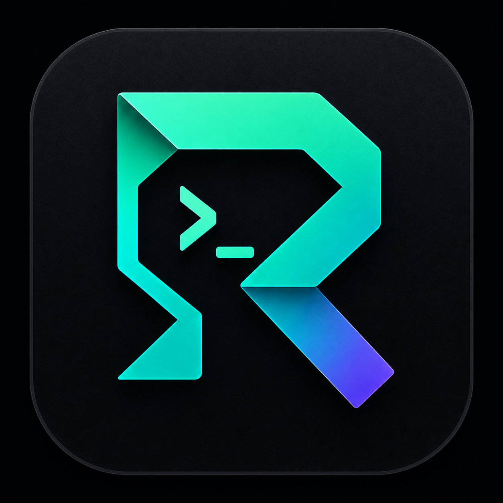
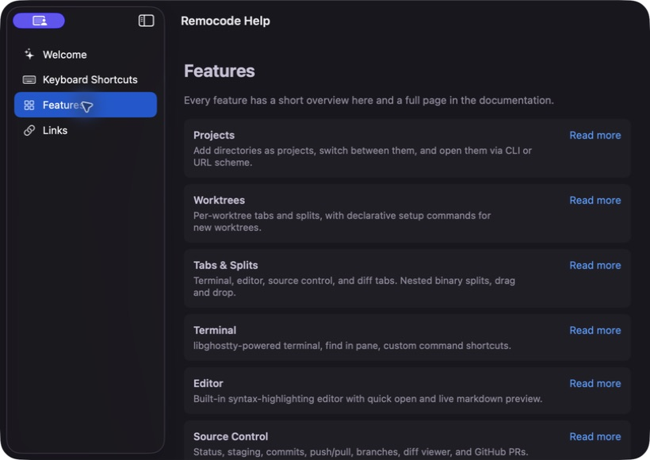
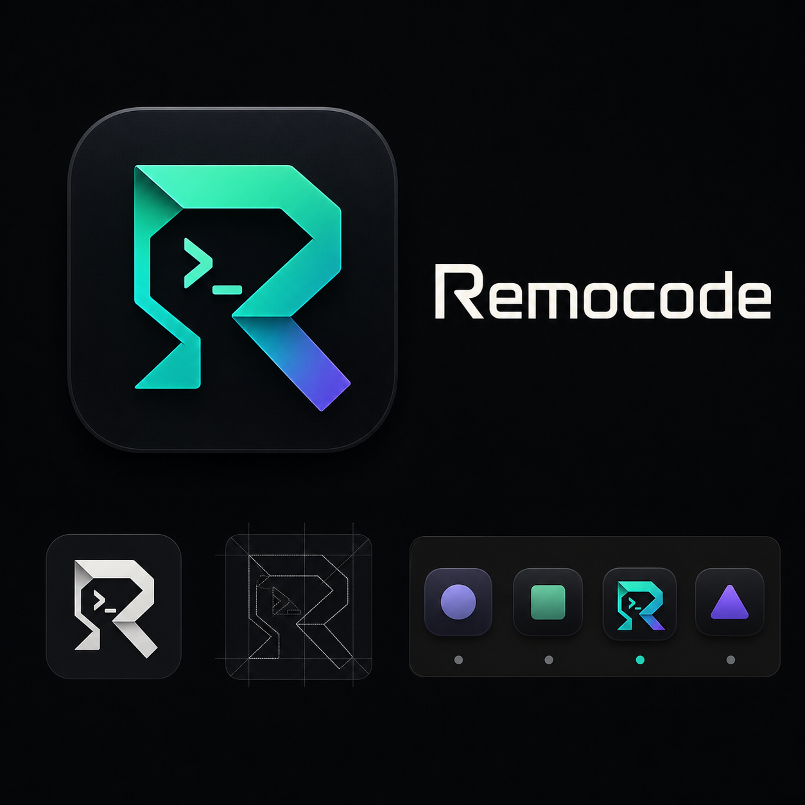

<div align="center">



# Remocode IDE

### 终端优先的 macOS 原生 IDE，为 Vibe Coding 而生

在 Mac 上组织项目、worktree、终端、文件和 Git；离开工位后，通过 iOS、Android 或 Web Remote 继续控制同一工作区。

[](https://github.com/BlueOriginAI/RemocodeIDE/releases/latest)
[](https://github.com/BlueOriginAI/RemocodeIDE/releases/latest)
[](https://github.com/BlueOriginAI/RemocodeIDE/releases/latest)
[](https://github.com/BlueOriginAI/RemocodeIDE/releases)

**[⬇️ 下载最新版](https://github.com/BlueOriginAI/RemocodeIDE/releases/latest)** · **[🌐 官网](https://ide.remocode.cc)** · **[🖥 Web Remote](https://ide.remocode.cc/app)** · **[📱 移动端](https://ide.remocode.cc/#remote)**

<br/>



</div>

---

## 一个围绕执行现场组织的 IDE

传统 IDE 往往从文件开始，Remocode 从正在运行的任务开始。终端是主工作区，文件树、编辑器、Git、PR 和 Agent 状态围绕当前项目展开，让你能在一个界面里完成“下任务、看输出、检查改动、继续迭代”。

| Terminal-first | Git-aware | Remote-ready |
| :-- | :-- | :-- |
| 启动后立即回到终端与 Session | 变更、Diff、提交、分支和 PR 保持在同一上下文 | iOS、Android 与浏览器连接你的 Mac 工作区 |

### 核心能力

- **项目与 worktree**：按项目管理终端和布局，每个 worktree 保留独立上下文。
- **终端、标签与分屏**：基于 libghostty 的原生终端，支持标签、嵌套分屏、搜索和自定义命令。
- **文件与编辑器**：内置文件树、Quick Open、语法高亮编辑器和 Markdown 预览。
- **Git 工作流**：查看变更、Diff、历史和分支，完成 stage、commit、push、pull 与 GitHub PR 操作。
- **Agent 协作**：在终端里运行 Claude Code、Codex 等 Agent，并在 AI Usage 面板查看支持的配额状态。
- **远程控制**：Mac 端生成 pairing URL；经本机批准后，手机或 Web Remote 可连接项目、Session、终端与 Git 视图。

<div align="center">


</div>

## 人在外面，工作区仍在 Mac 上

Remocode Remote 不是云端托管开发机。你的项目、终端和 Agent 仍运行在自己的 Mac 上；移动端或浏览器只在配对并获批后进行远程控制。

1. 在 Mac 端打开远程控制并生成 pairing URL。
2. 在 iOS / Android App 扫码，或打开 **[Web Remote](https://ide.remocode.cc/app)** 粘贴 URL。
3. 首次连接由 Mac 本机批准，无需暴露端口。
4. 远程查看项目与 Sessions、操作终端、检查 Git Diff，并上传图片或附件到当前会话。

```text
# Remocode Remote                                             ● 已连接

你          修复登录页在窄屏下的布局问题
Agent       ▶ 正在检查页面结构与响应式样式…
Agent       ✓ 已修改 2 个文件，类型检查和构建通过。
你          打开 Diff
Remocode    ● 已切换到当前 Session 的 Git 变更视图
```

## 下载与安装

当前 macOS 版本：**0.38.1 (arm64)**

| 文件 | 适用设备 | 系统要求 |
| --- | --- | --- |
| [**Remocode-0.38.1-arm64.dmg**](https://github.com/BlueOriginAI/RemocodeIDE/releases/download/v0.38.1/Remocode-0.38.1-arm64.dmg) | Apple Silicon（M 系列） | macOS 14 Sonoma 或更高版本 |

1. 下载并打开 DMG。
2. 把 **Remocode.app** 拖入「应用程序」。
3. 当前构建已签名但尚未经过 Apple 公证；首次启动如被 macOS 拦截，请在 Finder 中右键 Remocode，选择「打开」，再确认一次。
4. 后续版本可通过应用内置的 Sparkle 更新检查获取。

如需核对下载文件：

```bash
shasum -a 256 Remocode-0.38.1-arm64.dmg
# 2d95eb8e1296e35f4e83af63018f2abf68a498fa06f703a090e914b81bd5ec2c
```

## 免费能力与移动端订阅

- **Mac IDE 与 Web Remote 免费使用**。
- iOS / Android 的远程控制订阅在对应 App 内完成，由 App Store 或 Google Play 托管。
- Remocode 不要求创建官网账号；配对关系由你的设备本地管理。

订阅与平台说明见 **[ide.remocode.cc/#pricing](https://ide.remocode.cc/#pricing)**。

## 品牌

<div align="center">



</div>

新版图标以终端提示符和字母 R 为核心，青绿色代表持续运行的工作流，蓝紫色强调远程连接与跨设备延伸。

## 关于本仓库

本仓库仅用于维护 Remocode 的公开下载、Release 资产和产品介绍，不包含应用源代码。正式构建均通过 **[Releases](https://github.com/BlueOriginAI/RemocodeIDE/releases)** 发布。

<div align="center">

**[官网](https://ide.remocode.cc)** · **[Web Remote](https://ide.remocode.cc/app)** · **[下载](https://github.com/BlueOriginAI/RemocodeIDE/releases/latest)** · **[远程控制](https://ide.remocode.cc/#remote)** · **[订阅说明](https://ide.remocode.cc/#pricing)**

</div>
